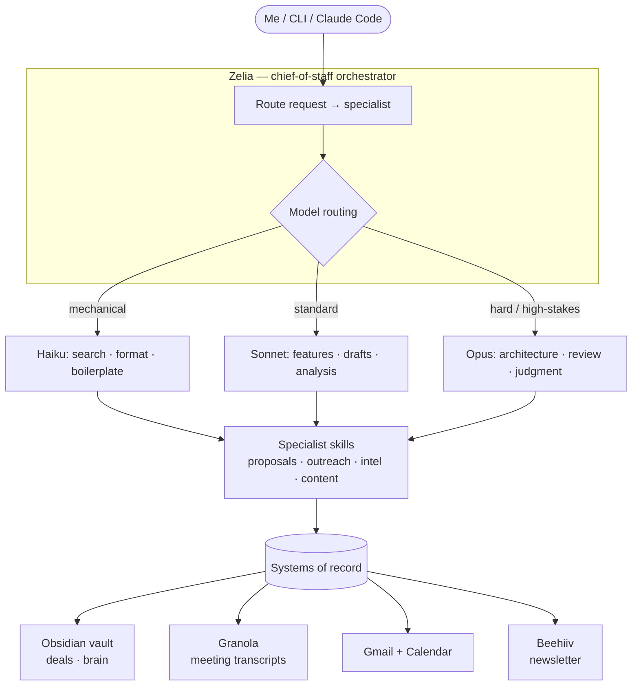

<div align="center">

# f13i-cli — an AI chief-of-staff for a solo consultancy

**The real system I use to run [f13i](https://f13i.com), my SaaS pricing consultancy.**
27 agents and skills, a model-routing execution layer, and a content-pipeline app —
all wired to my actual tools instead of a shadow database.

`pricing proposals` · `cold outbound` · `pricing intelligence` · `second-brain ops` · `content`

</div>

---

## Why this exists

I run f13i solo. The work is high-context — every pricing proposal, every prospect
call, every competitive brief needs the same discovery notes, deal history, and
frameworks pulled together by hand. That re-derivation was eating the day.

So I built **Zelia** — a chief-of-staff agent — and a library of specialist skills
around her. Each one encodes a workflow I used to do from scratch every time:
turning a discovery call into a defensible pricing proposal, scoring and sending
cold outreach, syncing my pipeline from Gmail and meeting transcripts, keeping my
second brain current. The system reads and writes my **real** sources of truth
(Obsidian, Granola, Gmail, Beehiiv) — there is no separate database to drift out
of sync.

It's also **self-improving**: one skill mines my own work history for repeated
manual tasks, another audits the library for dead weight, and a weekly review
promotes exactly one new skill to production.

> This is consulting work, built for f13i. My pricing background is from four years
> at Grafana Labs (previously — Sr. Manager, Commercialization & Pricing); the
> systems here are my own.

---

## Architecture



Two design rules the whole system follows:

1. **Expensive models think, cheap models execute.** Discovery and boilerplate run
   on Haiku; drafting and analysis on Sonnet; only genuinely ambiguous or
   high-stakes work reaches Opus. The tiered shell scripts in [`scripts/`](scripts/)
   are the cron-driven version of this.
2. **No shadow databases.** Skills read and write the tools I already live in.
   The board reflects Beehiiv; deal updates land in the Obsidian deal file; the
   pipeline is derived from Gmail + Granola. Nothing to keep in sync by hand.

---

## What's inside

### 🧠 Orchestration
| File | What it is |
| --- | --- |
| [`CLAUDE.md`](CLAUDE.md) / [`AGENTS.md`](AGENTS.md) | The **Zelia** spec — modes (morning snapshot, task routing, meeting debrief, session close), hard rules, and the creator/reviewer pattern. |
| [`index.js`](index.js) | `f13i <command>` CLI entry point. |

### ⚙️ Data agents ([`agents/`](agents/)) — Node, not LLM spawns
| Agent | Does |
| --- | --- |
| `outbound-sync.js` | Pulls Granola + Gmail + Calendar, writes the daily brief. |
| `action-items-sync.js` | Reconciles the action-items list from vault sources. |
| `deal-status-sync.js` | Deal pulse + recording-gap detection. |
| `pricing-intel.js` | Pricing intelligence run on a company. |
| `vault-sync.js` | Daily drift detector — keeps deal files current with reality. |

### 🛠️ Skills ([`skills/`](skills/)) — the specialist library
<details open>
<summary><b>Pricing deliverables</b> — the core billable work</summary>

- **`pricing-proposal-builder`** — a client-ready pricing / monetization / sales-comp plan, recommendation-led, every number defended with a framework and pressure-tested against a CEO.
- **`pricing-calculator-builder`** — a live, toggle-driven pricing model with cost/price curves and a hard floor clamp no discount stack can breach.
- **`client-safe-deliverable`** — turn an internal model (costs, margins, floors visible) into a clean client-facing version.
- **`pricingsaas-report-builder`** — analysis-first HTML pricing-intelligence briefs (PricingSaaS + Granola + vault).
</details>

<details>
<summary><b>Outreach & pipeline</b></summary>

- **`cold-email`** — draft, grade, and refine cold outreach in my voice.
- **`bulk-cold-email`** — score, personalize, and run outreach against a company list.
- **`outbound-sync`** — sync the pipeline from Gmail replies, Calendar, and Granola into deal files.
- **`call-prep`** — full pre-meeting prep workflow.
- **`deal-filer`** — file session artifacts into the right deal folder and update its index.
- **`coaching-call-update`** — investor-update-format prep for a coaching call.
</details>

<details>
<summary><b>Intelligence & research</b></summary>

- **`ci-pricing-job-scraper`** — scrape job boards for companies hiring pricing roles (a competitive signal).
- **`website-advisor`** — mine prospect conversations + the competitive landscape into prioritized f13i.com improvements.
</details>

<details>
<summary><b>Content</b></summary>

- **`linkedin-post-generator`** — LinkedIn posts in my voice on SaaS pricing.
- **`humanizer`** — strip the tells of AI-generated writing.
- **`childrens-story-builder`** — render fully illustrated children's books as self-contained HTML (a weekend project — kept for range).
</details>

<details>
<summary><b>Second-brain & knowledge ops</b></summary>

- **`load-f13i-docs`** — load my second-brain docs into context.
- **`business-doc-update`** — write session learnings back into the brain docs.
- **`weekly-brain-sync`** — batch-extract a week of Granola meetings into the second brain.
</details>

<details>
<summary><b>System / meta</b> — the self-improving loop</summary>

- **`leverage-finder`** — mine my own chat history for repeated manual work and propose new skills.
- **`skill-auditor`** — audit the library for dead weight, trigger collisions, and gaps.
- **`weekly-system-review`** — reconcile the registry and promote exactly one skill to production per week.
- **`netlify-deploy`** — build, validate, version, and ship f13i.com.
</details>

### 📊 Apps ([`apps/deal-room/`](apps/deal-room/))
**The Deal Room** — a kanban content-pipeline dashboard for my newsletter. Reads
Obsidian for ideas/drafts and Beehiiv for what's scheduled and live; drag-to-restage
writes back to note frontmatter (body-safe), no double-entry. Vite + React + TS.
See its [README](apps/deal-room/README.md).

---

## Running it

The skills run inside [Claude Code](https://claude.com/claude-code); the data agents
and CLI are plain Node.

```bash
npm install
cp .env.example .env      # fill in your own keys + vault path
node index.js call-prep "Nick from Acme"
```

`.env` is git-ignored; only the template ships. Everything defaults to `DRY_RUN=true`.
The skills are written against my own vault layout (Obsidian `30-deals/`, `10-brain/`,
etc.) — they're here as a reference architecture, not a drop-in product.

---

## About

Built by **Farhan Manjiyani** — founder of [f13i](https://f13i.com), a SaaS pricing
consultancy. Previously spent four years pricing at Grafana Labs (sub-$100M → $500M+
ARR, 13 products), including an AI launch that hit $1M ARR in 30 days at 15.2%
free-to-paid.

- 🌐 [f13i.com](https://f13i.com)
- 📬 The Deal Room — [f13i.beehiiv.com](https://f13i.beehiiv.com)
- 📅 [cal.com/farhan-m](https://cal.com/farhan-m)
- ✉️ me@f13i.com
