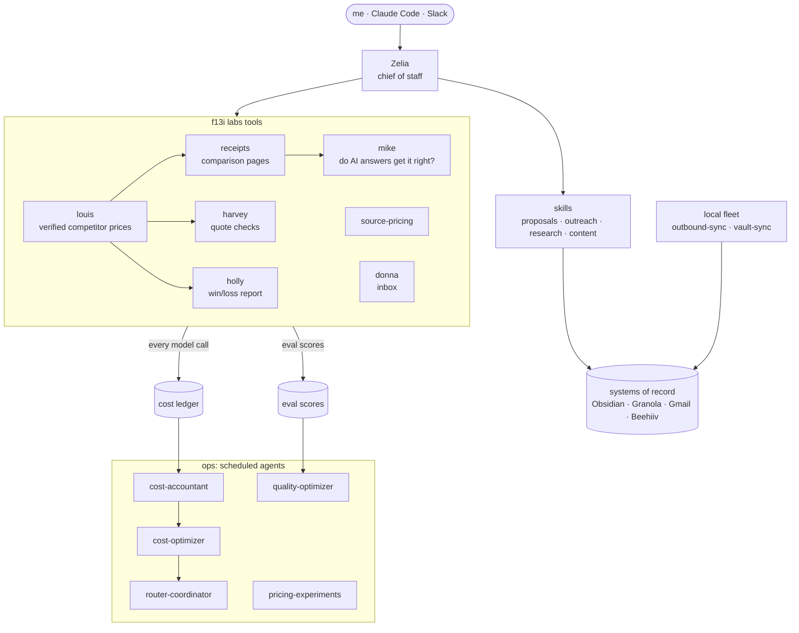

<div align="center">

# f13i-cli: the system that runs a solo pricing consultancy

**The real setup I use to run [f13i](https://f13i.com), my SaaS pricing consultancy.**
24 agents running on a schedule or always on, 23 skills in this repo,
and the f13i labs tools they connect to.

`pricing proposals` · `deal desk` · `competitor pricing` · `cost and quality control` · `content`

</div>

---

## Why this exists

I run f13i solo. Every pricing proposal, prospect call and competitive brief needs
the same notes, deal history and frameworks pulled together, and doing that by hand
was eating the day.

So I built it as a firm. **Zelia** is the chief of staff: she routes work to a
library of skills. **f13i labs** is the set of tools, each named after the person
at a firm who does that job: mike, louis, receipts, donna, harvey and holly. A
handful of scheduled agents keep the costs, quality and content moving without me
asking.

Everything reads and writes the tools I already use (Obsidian, Granola, Gmail,
Slack, Beehiiv). There is no separate database to keep in sync.

> My pricing background: four years at Grafana Labs, 17 products priced,
> $600M+ ARR, 80%+ margins. The systems here are my own.

---

## What's running

Checked 2026-11-25. "Running" means deployed, on a schedule, or run by cron on my Mac.

### f13i labs tools: deployed (5)

| tool | what it does | where it runs |
| --- | --- | --- |
| [mike](https://f13i.com/mike) | checks what chatgpt and claude tell buyers about your pricing | modal |
| [louis](https://f13i.com/louis) | weekly competitor pricing monitor, plus a slack agent that answers "what do they charge?" with sources | fly.io, slack |
| [harvey](https://f13i.com/harvey) | checks every quote in your slack against the pricing playbook; quotes are floor-clamped | fly.io, slack |
| [holly](https://f13i.com/holly) | studies where you win and lose against competitors and writes the report | fly.io, slack |
| source-pricing | source-based offers for shopify stores, tested inside the owner's price band; no model calls | fly.io |

Built and run on demand: [receipts](https://f13i.com/receipts) (comparison pages with
a source for every claim) and [donna](https://f13i.com/donna) (a keyboard-first inbox).

### Scheduled agents (17)

| agent | cadence | what it does |
| --- | --- | --- |
| cost-accountant | daily | rolls up every model call across the tools, per product and per client, and flags anomalies |
| cost-optimizer | weekly | finds cheaper ways to run the same calls (caching, smaller models, batching) and writes proposals |
| router-coordinator | weekly | tunes the claude/gpt router from judge scores; applies only approved proposals |
| quality-optimizer | weekly | reads every tool's eval scores, tests up to two fixes on branches, proposes them with before and after scores |
| pricing-experiments | weekly | designs and analyzes pricing tests for the f13i labs tools, with margin guardrails |
| client delivery (4) | weekdays and weekly | competitive digests, pricing recaps, deal-history updates and proposal follow-ups for active engagements; every one drafts for my approval (details stay private) |
| linkedin drafts | weekly | writes five dated pricing posts for review |
| linkedin publish | weekdays | posts the day's draft only if I've approved it |
| daily brief | weekdays | calendar and inbox summary before the day starts |
| coaching update | daily | drafts my coaching prep in investor-update format (to Gmail, never sent) |
| website-advisor | weekly | turns the week's prospect calls into ranked changes for f13i.com |
| vault lint | weekly | audits the second brain for broken links, stale notes and exposed secrets |
| leverage audit | weekly | looks at my recent work for repeated manual tasks worth turning into skills |
| system review | weekly | reconciles what is actually running and promotes one skill to a schedule |

The first five run against one shared cost ledger. Anything that sends, posts or
merges waits for my approval.

### Local fleet: cron and launchd on my Mac (2)

| agent | cadence | what it does |
| --- | --- | --- |
| [`outbound-sync.js`](agents/outbound-sync.js) | 7am and 6pm weekdays, Sunday 8am | pulls Granola, Gmail and Calendar, writes the daily brief, detects changes |
| [`vault-sync.js`](agents/vault-sync.js) | 9am and 5pm | drift detector: flags deal files that no longer match reality |

The cron jobs are tiered: [`tier1-sync.sh`](scripts/tier1-sync.sh) is a free data
sync, and [`tier2-reasoning.sh`](scripts/tier2-reasoning.sh) only spends on model
calls when tier 1 finds something new.

---

## How it fits together



Three rules hold across all of it:

1. **Expensive models think, cheap models execute.** Search and boilerplate go to
   Haiku, drafting and analysis to Sonnet, and only hard or high-stakes work to Opus.
   The router-coordinator tunes this from real scores every week.
2. **No shadow databases.** Tools share facts through files with a source URL and a
   verified date, not by importing each other's code. A price nobody read on the page
   doesn't get quoted.
3. **Nothing goes out without a yes.** Agents draft, propose and open pull requests.
   Sending, posting, merging and deploying wait for approval.

---

## Design decisions

The parts I'd point to if you're building something like this.

- **The model never sets the price.** harvey's quotes go through a deterministic
  floor clamp (`harvey quote <sku>:<qty>` runs with no model at all). The model can
  explain and negotiate; it can't go below the floor. source-pricing makes no model
  calls at all.
- **Facts are a contract, not a vibe.** louis, receipts and mike each write what they
  verified to an append-only file with the source URL and the date it was read. The
  others read from there. A number with no source doesn't get used.
- **Every model call is metered.** Each tool logs its calls to one ledger, tagged by
  product, agent and client vs internal. The cost-accountant rolls it up daily, so I
  know what a run costs before I price the tool.
- **Quality is measured, not felt.** louis, harvey, holly and receipts each have an
  eval suite that writes a score line on every run. The quality-optimizer tests fixes
  on a branch and proposes them with the before and after scores.
- **Spend only when something changed.** The local fleet runs a free sync first and
  only calls a model when the sync finds new data.
- **Approvals live where I already look.** A proposal is a note in my vault;
  approving it is changing `status: approved` in its frontmatter. No dashboard to
  remember to check.
- **Tools don't import each other.** Each one deploys on its own. Shared code moves
  into a common library only after the same code shows up in three tools.

## What broke and what I changed

Running 24 agents taught me more than building them.

- **"Last run: today" isn't proof it worked.** Four scheduled agents fired on time
  for five weeks while writing their output to a folder that was wiped after each
  run. The scheduler looked healthy the whole time. Now every agent's review checks
  that its output file actually landed, not just that it ran.
- **Agents were running in places I wasn't looking.** My first inventory missed
  half the system: cron jobs, a launchd job and two separate scheduled-task folders.
  The weekly system review now checks every surface and lists any it couldn't check,
  instead of treating "not found" as "not running".
- **A skill that degrades quietly is worse than one that fails.** Three skills were
  calling tool names that no longer existed and kept going without the data. They
  now check their tools up front and stop loudly if one is missing.
- **More reviewers isn't better.** At one point three meta-agents were auditing the
  same skills on the same morning. The rule now: promote at most one skill to a
  schedule per week, and retire before you add.

---

## What's in this repo

This repo is the Zelia side: the orchestrator spec, the local agents and the skills.
The f13i labs tools live in their own repos.

### Orchestration
| file | what it is |
| --- | --- |
| [`CLAUDE.md`](CLAUDE.md) / [`AGENTS.md`](AGENTS.md) | the Zelia spec: modes (morning snapshot, task routing, meeting debrief, session close), hard rules, and the creator/reviewer pattern |
| [`index.js`](index.js) | `f13i <command>` CLI entry point |

### Data agents ([`agents/`](agents/)): Node, not LLM spawns
| agent | does |
| --- | --- |
| `outbound-sync.js` | pulls Granola, Gmail and Calendar, writes the daily brief |
| `vault-sync.js` | daily drift detector that keeps deal files current |
| `action-items-sync.js` | reconciles the action-items list from vault sources |
| `deal-status-sync.js` | deal pulse and recording-gap detection |
| `pricing-intel.js` | pricing intelligence run on a company |
| `linkedin-publish.js` | posts the day's approved LinkedIn draft, with its image, through the LinkedIn API |

### Skills ([`skills/`](skills/))
<details open>
<summary><b>Pricing deliverables</b>: the core billable work</summary>

- **`pricing-proposal-builder`**: a client-ready pricing, packaging or sales-comp plan, recommendation-led, every number defended with a framework and pressure-tested against a CEO.
- **`pricing-calculator-builder`**: a live, toggle-driven pricing model with cost and price curves and a hard floor no discount stack can breach.
- **`client-safe-deliverable`**: turns an internal model (costs, margins, floors) into a clean client-facing version and scans it for leaks.
- **`pricingsaas-report-builder`**: analysis-first HTML pricing briefs.
</details>

<details>
<summary><b>Outreach and pipeline</b></summary>

- **`cold-email`**: draft, grade and refine cold outreach.
- **`bulk-cold-email`**: score, research and draft outreach for a list of companies.
- **`outbound-sync`**: sync the pipeline from Gmail replies, Calendar and Granola into deal files.
- **`call-prep`**: the full pre-meeting brief.
- **`deal-filer`**: file a session's work into the right deal folder.
- **`coaching-call-update`**: investor-update-format prep for a coaching call.
</details>

<details>
<summary><b>Research</b></summary>

- **`ci-pricing-job-scraper`**: find companies hiring for pricing roles.
- **`website-advisor`**: turn prospect conversations and competitor sites into ranked changes for f13i.com.
- **`wtp-call-digest`**: turn a batch of willingness-to-pay interviews into a per-buyer number table, a cross-read and a readout.
</details>

<details>
<summary><b>Content</b></summary>

- **`linkedin-post-generator`**: LinkedIn posts on SaaS pricing in my voice.
- **`humanizer`**: strip the tells of AI-generated writing.
- **`childrens-story-builder`**: illustrated children's books as self-contained HTML (a weekend project, kept for range).
</details>

<details>
<summary><b>Second brain</b></summary>

- **`load-f13i-docs`**: load my second-brain docs into context.
- **`business-doc-update`**: write a session's decisions back into the docs.
- **`weekly-brain-sync`**: pull a week of meetings into the second brain.
</details>

<details>
<summary><b>System</b>: the loop that keeps it honest</summary>

- **`leverage-finder`**: find repeated manual work worth automating.
- **`skill-auditor`**: find dead skills, trigger collisions and gaps.
- **`weekly-system-review`**: reconcile what's running and promote one skill a week.
- **`netlify-deploy`**: build, validate and ship f13i.com.
</details>

### Side automation ([`atlas-calendar-automation/`](atlas-calendar-automation/))
A Google Apps Script that scrapes a training organization's schedule each week,
appends new sessions to a sheet and creates the matching calendar events. Append
and create only; it never edits or deletes. A small example of the same rule:
automate the chore end to end, and make it safe to run twice.

### Apps ([`apps/deal-room/`](apps/deal-room/))
**The Deal Room**: a kanban board for my newsletter pipeline. It reads Obsidian for
ideas and drafts and Beehiiv for what's scheduled and live; dragging a card writes
back to the note's frontmatter. Vite, React, TypeScript. See its
[README](apps/deal-room/README.md).

---

## Running it

The skills run inside [Claude Code](https://claude.com/claude-code); the data agents
and CLI are plain Node.

```bash
npm install
cp .env.example .env      # your own keys and vault path
node index.js call-prep "Nick from Acme"
```

`.env` is git-ignored; only the template ships. Everything defaults to `DRY_RUN=true`.
The skills are written against my own vault layout (`30-deals/`, `10-brain/` and so
on), so treat them as a reference, not a drop-in product.

---

## About

Built by **Farhan Manjiyani**, founder of [f13i](https://f13i.com). Four years pricing
at Grafana Labs: 17 products, $600M+ ARR, 80%+ margins.

- [f13i.com](https://f13i.com) · [f13i labs](https://f13i.com/labs)
- The Deal Room: [f13i.beehiiv.com](https://f13i.beehiiv.com)
- [cal.com/farhan-m](https://cal.com/farhan-m)
- me@f13i.com
